# Architecture: College Management System

The full architecture of the system, shown in diagrams.
**Order of authority:** `docs/PRD.md` → `docs/spec/*` → this document. If a diagram here disagrees with the PRD or a spec, the PRD/spec wins and this file is fixed.
Related: `docs/tech.stack.md` (libraries, hosting), `docs/spec/` (buildable details), `docs/implementation/` (build plans).

Diagrams use **Mermaid**, which GitHub and VS Code (with a Mermaid preview extension) render directly.

## Contents

1. [Architecture at a glance](#1-architecture-at-a-glance)
2. [System context](#2-system-context)
3. [Deployment](#3-deployment)
4. [Inside the Node process](#4-inside-the-node-process)
5. [Repository and code structure](#5-repository-and-code-structure)
6. [Backend modules](#6-backend-modules)
7. [Request pipeline](#7-request-pipeline)
8. [Roles and permissions](#8-roles-and-permissions)
9. [Academic structure](#9-academic-structure)
10. [Data model](#10-data-model)
11. [Authentication and sessions](#11-authentication-and-sessions)
12. [Account lifecycle](#12-account-lifecycle)
13. [Schedule, Class Meetings and attendance](#13-schedule-class-meetings-and-attendance)
14. [Exams and quizzes](#14-exams-and-quizzes)
15. [Community feed and pinned posts](#15-community-feed-and-pinned-posts)
16. [Real-time chat](#16-real-time-chat)
17. [Notices, notifications, email and push](#17-notices-notifications-email-and-push)
18. [Learning content and online classes](#18-learning-content-and-online-classes)
19. [File storage](#19-file-storage)
20. [Book shop](#20-book-shop)
21. [AI study assistant](#21-ai-study-assistant)
22. [Background jobs](#22-background-jobs)
23. [Security architecture](#23-security-architecture)
24. [Frontend architecture](#24-frontend-architecture)
25. [CI/CD and environments](#25-cicd-and-environments)
26. [Quality attributes and how the design meets them](#26-quality-attributes-and-how-the-design-meets-them)
27. [Key architecture decisions](#27-key-architecture-decisions)

---

## 1. Architecture at a glance

| Aspect | Choice |
|---|---|
| Style | **Modular monolith**: one repo, one Node process, one database. Modules are split by feature (`auth`, `academics`, `exams`, …) with strict boundaries. |
| Frontend | Next.js (App Router) + Tailwind + shadcn/ui, phone-first (360 px). Talks **only** to the Express API. |
| Backend | Express + Socket.IO + pg-boss, TypeScript. All business rules and permission checks live here. |
| Data | PostgreSQL on Supabase via Prisma. Sessions, rate limits and the job queue also live in PostgreSQL. **No Redis.** |
| Files | Supabase Storage: `private` bucket (signed URLs) and a small `public` bucket. |
| External | Gmail SMTP (email), Groq (AI), Google Meet / Jitsi (live class links), YouTube / Google Drive (recordings). |
| Hosting | Render free web service + Supabase free plan. Cost: **zero**. |
| Users | ~3,000 users, ~500 concurrent exam takers, ~95% on phones. One Admin, teachers, students (some under 18). |

---

## 2. System context

Who uses the system and which outside services it talks to.

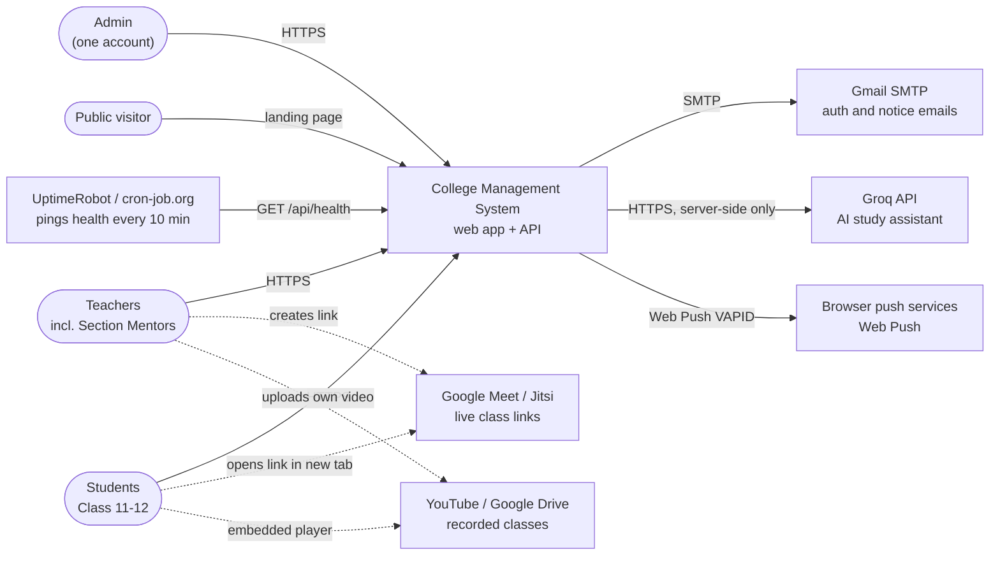

There is **no** integration with Meet, Jitsi or YouTube: teachers paste links; the app stores and shows them.

---

## 3. Deployment

One free Render web service runs everything. Supabase holds the database and files.

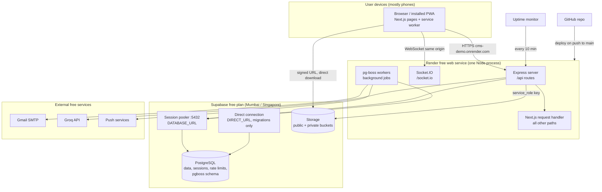

Notes:
- **One address, one cookie:** Express hands every non-API request to Next.js, so the session cookie is first-party and there is no CORS.
- **Files never pass through Express on download:** the browser fetches them from Supabase with a short-lived signed URL (saves RAM on the free plan).
- **Keep-awake:** the uptime monitor stops Render from sleeping and Supabase from pausing. If Render does sleep, jobs run late but stay correct (Section 22).
- **Later (real launch, still free):** the same app in Docker on an Oracle Cloud Always Free VM with Caddy for HTTPS; files can stay on Supabase.

---

## 4. Inside the Node process

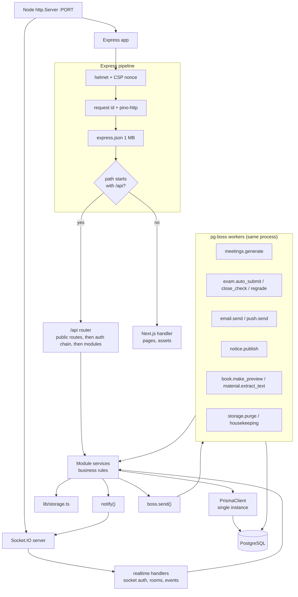

Startup order: validate env (`config.ts`, exit on error) → connect Prisma → start pg-boss and register jobs → run missed crons once (meeting generation, expired attempts) → prepare Next.js → listen.
Shutdown order: stop accepting → close sockets → `boss.stop()` → `prisma.$disconnect()`.

---

## 5. Repository and code structure

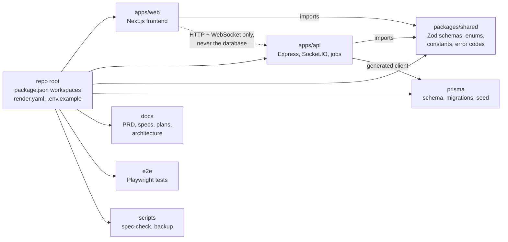

```
apps/api/src
  server.ts  config.ts  db.ts
  middleware/   session, csrf, requireRole, rateLimit, upload, errorHandler
  lib/          permissions, storage, mail, audit, time, push, pagination, http
  modules/<m>/  routes.ts · service.ts · policy.ts · *.test.ts
  jobs/         index.ts + one file per job
  realtime/     socket auth, rooms, event handlers

apps/web/src
  app/          (public) · (onboarding) · (app)/admin|teacher|student|feed|messages|…
  components/   ui/ (shadcn) · shared/ · feature folders
  lib/          api.ts · queryKeys.ts · socket.ts · time utils
```

**Rule of the layers:** route (authenticate → authorize → validate → call service → respond) → service (rules, receives `actor`, never `req`) → Prisma. Shared Zod schemas validate both the API and the forms.

---

## 6. Backend modules

Each box is a folder in `apps/api/src/modules/`. Arrows mean "calls the service of".

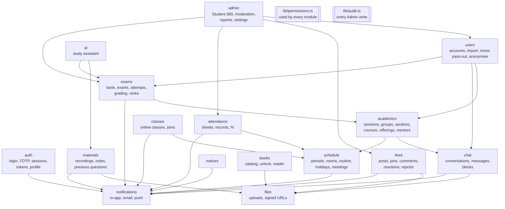

Cross-cutting helpers every module uses: `permissions.ts` (role + assignment checks), `audit()` (Admin writes), `notify()` (notifications), `storage.ts` (files), `time.ts` (Asia/Dhaka), `chatMembership.sync()` (group/section chats), `revokeAllSessions()` (logout everywhere).

---

## 7. Request pipeline

Every `/api` request goes through the same chain. Public routes are mounted before the auth chain.

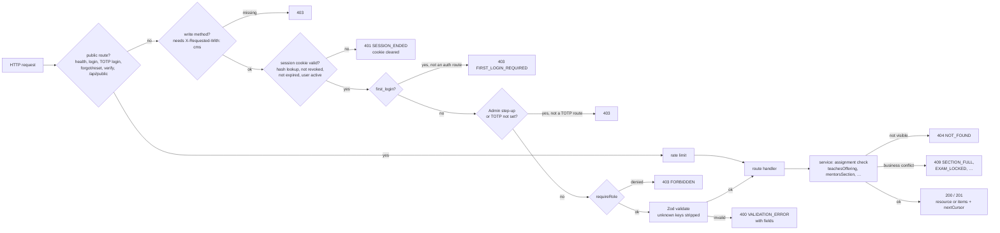

All errors use one shape: `{ "error": { "code", "message", "fields?" } }`. A 500 never includes a stack trace.

---

## 8. Roles and permissions

```mermaid
flowchart TB
    subgraph roles["Roles (User.role)"]
        A["admin<br/>exactly one account"]
        T["teacher"]
        S["student"]
    end

    subgraph assign["Assignments (from data, not roles)"]
        CT["Course teacher<br/>CourseOffering.teacherId"]
        SM["Section Mentor<br/>Section.mentorTeacherId<br/>max one section per teacher"]
        EN["Enrolled student<br/>active Enrollment"]
        SUB["Substitute<br/>ClassMeeting.substituteTeacherId"]
    end

    T --> CT
    T --> SM
    T --> SUB
    S --> EN

    A -->|"everything Admin-controlled:<br/>accounts, sessions, schedule,<br/>moderation, books, settings"| ALL["all data<br/>(never AI chats)"]
    CT -->|"own offerings: classes, recordings,<br/>notes, exams, attendance, notices"| OFF["offering data"]
    SM -->|"own section: attendance, notices,<br/>pins, recordings, notes, monitoring"| SEC["section data"]
    EN -->|"own courses, own results,<br/>own attendance"| OWN["own data"]
```

| Policy helper (`lib/permissions.ts`) | True when |
|---|---|
| `isAdmin` | role = admin |
| `teachesOffering` | actor is the offering's teacher |
| `mentorsSection` | actor is the section's mentor |
| `teachesInSection` | actor teaches any offering of the section |
| `canManageOffering` | admin, offering teacher, or mentor where the PRD allows |
| `isEnrolled` | student has an active enrollment |
| `canTakeAttendance` | admin, meeting teacher, substitute, or mentor of a covered section |
| `canSeeStudentPrivate` | admin or the student themself |

Hiding buttons in the UI is cosmetic. **The API is the guard**, and objects the actor may not see return 404.

---

## 9. Academic structure

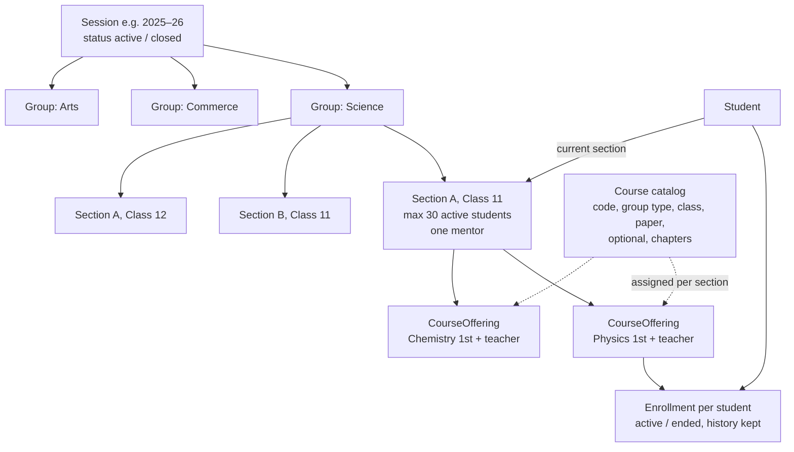

- Creating a session creates exactly 3 groups, each with a default Section A.
- Moving or promoting a student ends old enrollments and creates new ones; past attendance and attempts keep their stored `sectionId`.
- Closing a session (pass-out) is a manual Admin action, never automatic.

---

## 10. Data model

The full schema (about 70 models) is in `docs/spec/01-database.md`. The diagrams below show the main entities and relations by domain.

### 10.1 People, access and academics

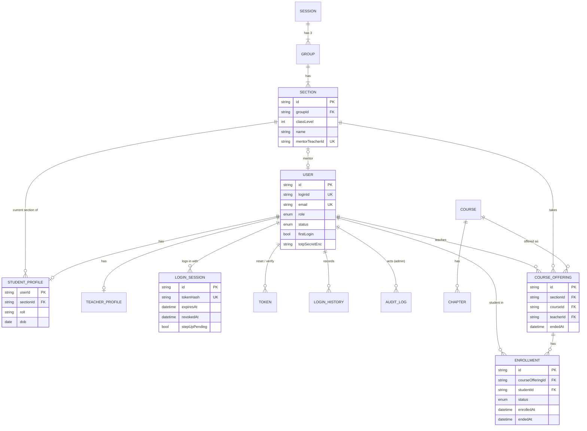

### 10.2 Schedule and attendance

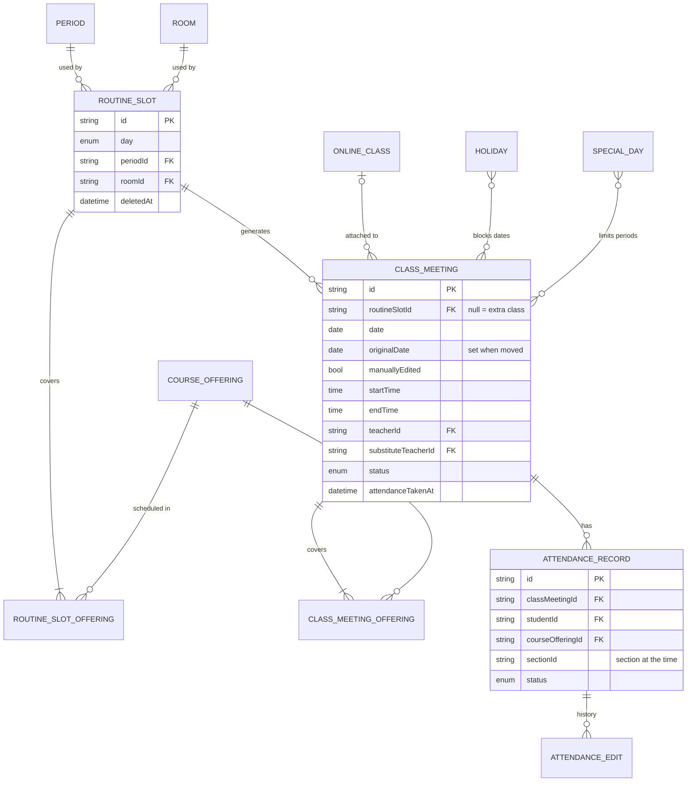

### 10.3 Exams

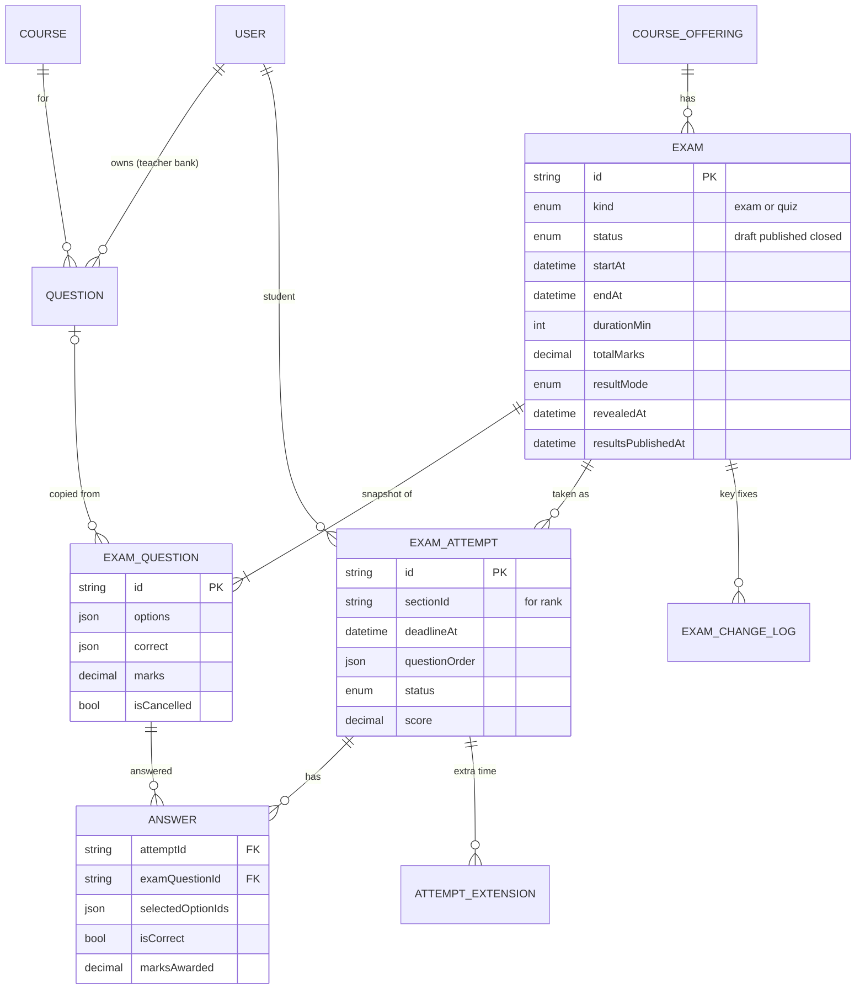

### 10.4 Community, chat and notices

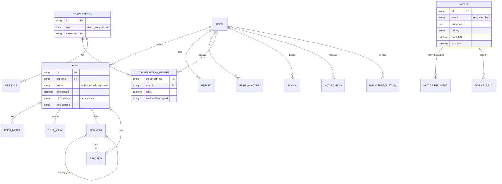

### 10.5 Content, books, AI and system

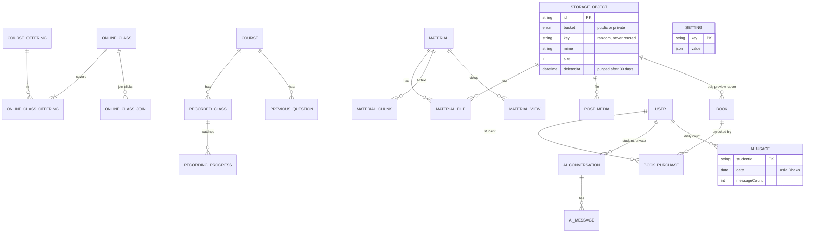

**Database rules:** every change is a Prisma migration; constraints Prisma can't express (CHECKs, partial unique indexes, the meeting expression index, full-text `tsvector`) are raw SQL in the same migration; **Row Level Security is on for every table with no policies**, so Supabase's public REST API can read nothing.

---

## 11. Authentication and sessions

### 11.1 Login (teacher / student, and Admin with TOTP)

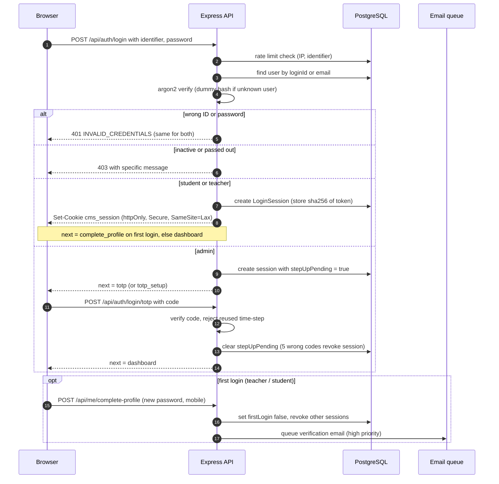

### 11.2 Session states

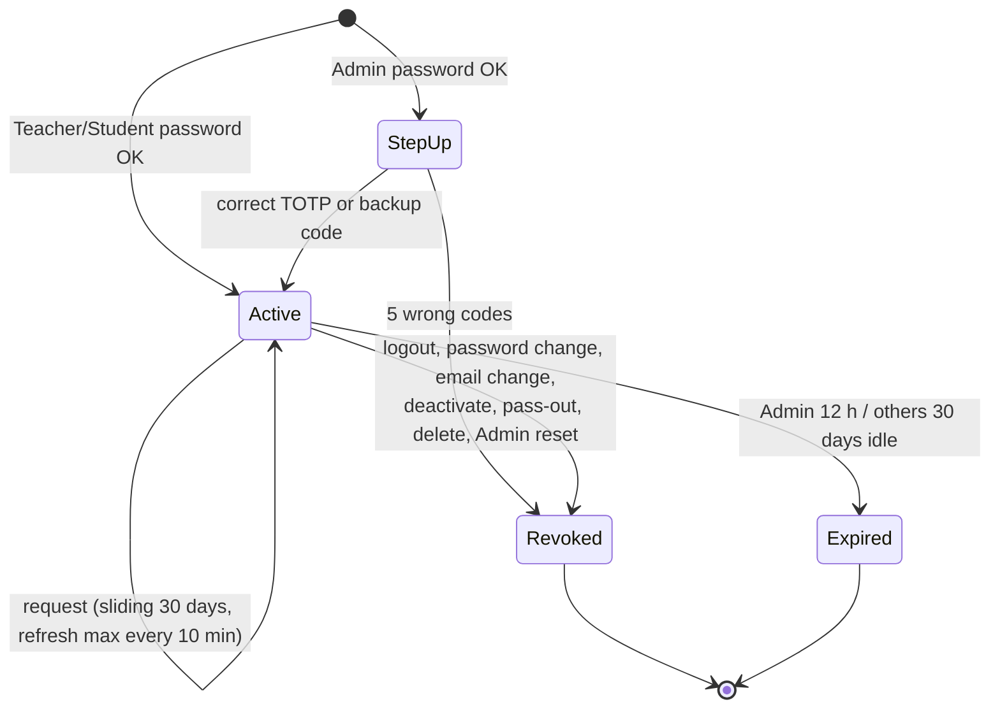

`revokeAllSessions()` is the single place that ends sessions. It also sends `session:revoked` to the user's sockets and disconnects them.

---

## 12. Account lifecycle

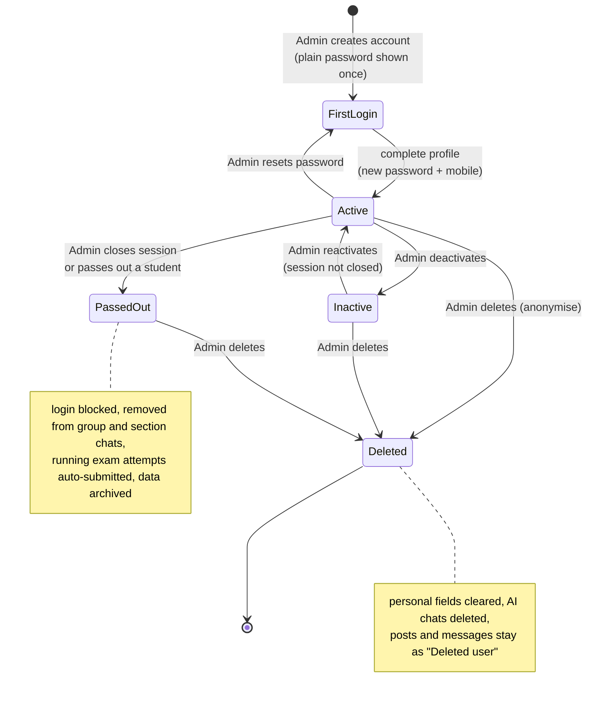

---

## 13. Schedule, Class Meetings and attendance

### 13.1 From routine to attendance

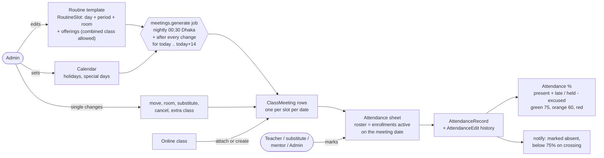

### 13.2 Class Meeting states

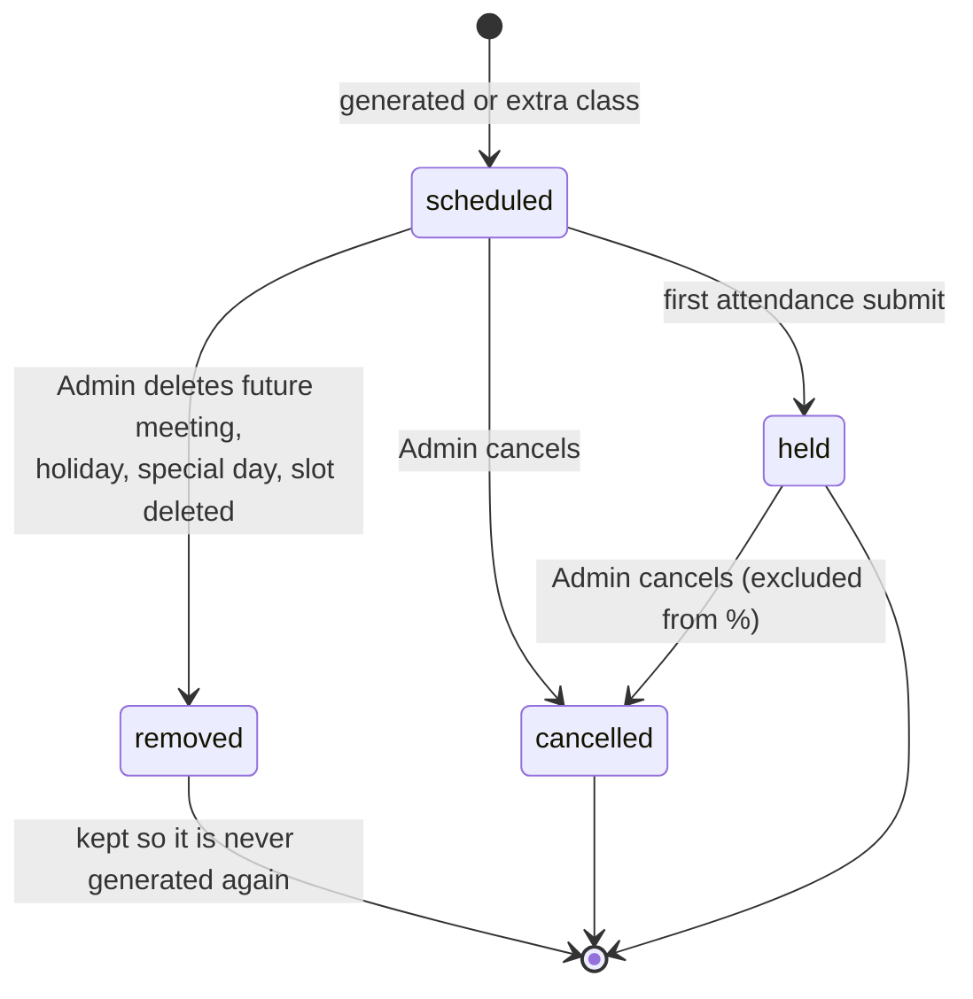

### 13.3 Generator rules (idempotent)

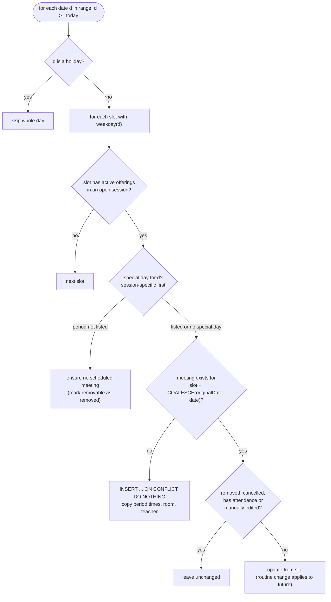

### 13.4 Taking attendance

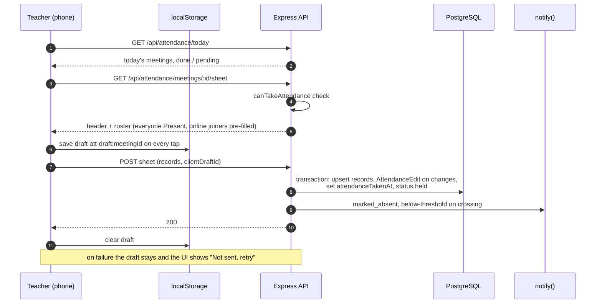

---

## 14. Exams and quizzes

### 14.1 Exam lifecycle

```mermaid
stateDiagram-v2
    [*] --> draft: teacher creates
    draft --> published: publish (questions snapshotted,<br/>jobs scheduled, students notified)
    published --> published: edit before startAt<br/>(stays published, questions re-snapshotted)
    published --> live: startAt reached
    live --> live: fix answer key, cancel question,<br/>extra time (only allowed edits)
    live --> closed: endAt passed and<br/>no attempt in progress
    closed --> [*]

    note right of closed
        revealedAt set; instant mode publishes results
        automatically, manual mode waits for the teacher
    end note
```

### 14.2 Attempt states

```mermaid
stateDiagram-v2
    [*] --> in_progress: start (deadline = min(now + duration, endAt))
    in_progress --> submitted: student submits
    in_progress --> auto_submitted: deadline reached<br/>(job or lazy check)
    auto_submitted --> in_progress: teacher reopens with extra time
    submitted --> in_progress: teacher reopens with extra time
    submitted --> [*]
    auto_submitted --> [*]
```

### 14.3 Taking an exam

```mermaid
sequenceDiagram
    autonumber
    participant S as Student (phone)
    participant API as Express API
    participant DB as PostgreSQL
    participant J as pg-boss

    S->>API: POST /api/exams/:id/attempts
    API->>DB: lock exam row, check enrollment, window, attempts left
    API->>DB: insert attempt (deadlineAt, sectionId, shuffled order)
    API->>J: schedule exam.auto_submit at deadlineAt
    API-->>S: questions WITHOUT correct answers, deadlineAt, serverNow
    loop every tap
        S->>API: PUT answers/:examQuestionId
        API->>DB: one indexed write, only if now < deadlineAt
        API-->>S: saved tick (or 409 DEADLINE_PASSED)
    end
    S->>API: POST integrity events (batched every 10 s)
    alt student submits
        S->>API: POST submit
        API->>DB: grade on server, status submitted
    else browser closed
        J->>API: exam.auto_submit at deadline
        API->>DB: grade, status auto_submitted
    end
    Note over API,DB: correctness never depends on the job:<br/>every answer checks the deadline and expired attempts are finalised on read
```

### 14.4 Grading and what students see

```mermaid
flowchart TB
    q["each exam question"] --> c{"cancelled?"}
    c -->|yes| full["award full marks to everyone"]
    c -->|no| m{"selected set ==<br/>correct set exactly?"}
    m -->|yes| right["award the question's marks"]
    m -->|"no or unanswered"| zero["award 0<br/>no negative, no partial"]
    full --> sum["score = sum of awarded"]
    right --> sum
    zero --> sum

    sum --> vis{"what the student sees"}
    vis -->|"before reveal, instant mode"| v1["total score only"]
    vis -->|"before results, manual mode"| v2["Submitted, result pending"]
    vis -->|"after reveal + results published"| v3["per-question result, section rank,<br/>correct answers only if showAnswersAfterEnd"]
```

Ranks use competition ranking (1, 2, 2, 4) **within the section of the attempt**. Overall course rank = average % over published Exams (missed = 0%), quizzes excluded.

---

## 15. Community feed and pinned posts

### 15.1 Building the feed

```mermaid
flowchart TB
    req["GET /api/feed (first page)"] --> pinned["pinned for me:<br/>published, pinnedUntil > now,<br/>audience all OR my section,<br/>no PostView by me"]
    pinned --> order["Admin pins newest first,<br/>then mentor pins newest first"]
    req --> items["all other published posts<br/>newest first, 20 per page,<br/>excluding the pinned ones above"]
    order --> resp["response: pinned[] + items[] + nextCursor"]
    items --> resp
    resp --> ui["UI: 5 pins expanded,<br/>'Show N more announcements'"]
    ui --> seen["card at least 50% visible for 1 s<br/>POST /api/feed/seen"]
    seen --> pv[("PostView")]
    pv -.->|next load| pinned
```

### 15.2 Pinned post lifecycle

```mermaid
stateDiagram-v2
    [*] --> PinnedUnseen: Admin or Section Mentor posts<br/>with pin on (only at creation)
    PinnedUnseen --> Timeline: user has seen it (next load)
    PinnedUnseen --> Timeline: 7 days passed (pin_days)
    PinnedUnseen --> Timeline: Admin unpins
    Timeline --> PinnedUnseen: Admin extends<br/>(only for users who have not seen it)
    Timeline --> [*]
```

### 15.3 Moderation

```mermaid
flowchart LR
    post["post / comment"] --> bw{"banned word?"}
    bw -->|yes| held["held: visible to author + Admin"]
    bw -->|no| pub["published"]
    pub --> rep["users report it"]
    rep --> queue["Admin moderation queue"]
    held --> queue
    queue --> act{"Admin action"}
    act --> d1["dismiss"]
    act --> d2["delete (removed 30 days, then hard delete)"]
    act --> d3["delete + warn"]
    act --> d4["mute N days<br/>(no posts, comments, messages)"]
    act --> d5["approve held item"]
    d2 --> aud[("AuditLog + author notified")]
    d3 --> aud
    d4 --> aud
```

---

## 16. Real-time chat

### 16.1 Socket rooms

```mermaid
flowchart LR
    sock["Socket connection<br/>(cookie checked like HTTP)"] --> ru["room user:id<br/>notifications, session revoked"]
    sock --> rc1["room conv:id for every<br/>active membership"]
    sync["chatMembership.sync()<br/>after create, move, pass-out,<br/>mentor or teacher change"] -->|socketsJoin / socketsLeave| rc1

    subgraph types["Conversation types"]
        direct["direct: two users<br/>student-student, teacher-student,<br/>teacher-teacher, Admin-anyone"]
        group["group: students of a session group<br/>+ mentors of its sections"]
        section["section: section students + mentor<br/>+ teachers of its offerings"]
    end
```

The Admin is never in group or section chats; the Admin sees a chat only through a report (the message plus 10 before and 10 after).

### 16.2 Sending a message

```mermaid
sequenceDiagram
    autonumber
    participant A as Sender
    participant IO as Socket.IO server
    participant SVC as chat service
    participant DB as PostgreSQL
    participant B as Receiver (online)
    participant N as notify() / push

    A->>IO: msg:send (conversationId, clientId, text)
    IO->>SVC: same rules as REST
    SVC->>SVC: member? not left? not muted? not blocked?<br/>30 per min? banned word?
    alt rule fails
        SVC-->>A: ack ok false + code (422 BLOCKED_WORD stores nothing)
    else ok
        SVC->>DB: persist message, update lastMessageAt
        SVC-->>A: ack ok true + message
        SVC->>IO: emit msg:new to conv:id
        IO-->>B: msg:new
        SVC->>N: offline members: new_message (max 1 per conversation per 5 min)
        B->>IO: msg:read (lastReadMessageId, forward only)
        IO-->>A: msg:read, shows "Seen"
    end
    Note over A,B: on reconnect the client fetches messages after its last id
```

---

## 17. Notices, notifications, email and push

### 17.1 Notification fan-out

```mermaid
flowchart LR
    ev["any event<br/>(notice, exam, absent,<br/>message, pin, …)"] --> notify["notify(userIds, type, ref, text)"]
    notify --> row[("Notification rows")]
    notify --> sock["socket notif:new<br/>with unread count"]
    notify --> prefs{"user prefs<br/>per type"}
    prefs -->|push on| pq["push.send job"]
    prefs -->|"email on, or urgent notice<br/>(cannot be turned off)"| eq["email.send job"]
    pq --> ws["web-push<br/>title + generic text only<br/>404/410 deletes subscription"]
    eq --> quota{"EmailQuota today<br/>below daily limit?"}
    quota -->|yes| smtp["Gmail SMTP<br/>3 retries, backoff"]
    quota -->|no| tomorrow["retry 00:05 Dhaka next day"]
    smtp -->|SMTP blocked| log["demo: link written to log<br/>(LOG_EMAIL_LINKS)"]
```

Email priority: **high** (reset, verification, email change) goes first and may use the last 10% of the daily limit; **normal** (notices) stops at 90%. In-app notifications are never delayed by email.

### 17.2 Publishing a notice

```mermaid
sequenceDiagram
    autonumber
    participant Au as Admin / teacher / mentor
    participant API as Express API
    participant J as notice.publish job
    participant DB as PostgreSQL
    participant N as notify()

    Au->>API: POST /api/notices (audience, sanitised HTML, priority, publishAt)
    API->>API: check audience allowed for author
    API->>DB: save notice
    API->>J: schedule at publishAt (now if empty)
    J->>DB: skip if already published (idempotent)
    J->>DB: resolve audience, insert NoticeRecipient in batches of 1,000
    J->>N: notice_new to all recipients (socket + push)
    J->>N: email if important or urgent
    J->>DB: set publishedAt
```

---

## 18. Learning content and online classes

```mermaid
flowchart TB
    subgraph live["Online class (no video integration)"]
        oc["Teacher pastes Meet / Jitsi https link<br/>for one or more own offerings"] --> attach["attach to the routine meeting<br/>at that time, or create an extra meeting"]
        oc --> remind["jobs: reminder at start - 15 min,<br/>status live / ended"]
        join["Student taps Join<br/>(start - 10 min .. end)"] --> log[("OnlineClassJoin")]
        log --> prefill["pre-fills attendance"]
        join --> newtab["opens the link in a new tab"]
    end

    subgraph rec["Recorded classes"]
        url["YouTube or Drive link"] --> parse["URL parser → videoId<br/>(other hosts rejected)"]
        parse --> embed["youtube-nocookie / Drive preview iframe"]
        embed --> watched[("RecordingProgress = watched")]
    end

    subgraph notes["Notes, materials, previous questions"]
        up["Upload (type checked by content)"] --> so[("StorageObject, private")]
        open["Student opens file"] --> chk["visibility check:<br/>enrolled offering, own section,<br/>own group, or college-wide"]
        chk --> mv[("MaterialView")]
        mv --> signed["302 to 5-minute signed URL"]
        up -->|PDF| extract["material.extract_text job<br/>→ MaterialChunk for AI"]
    end
```

---

## 19. File storage

### 19.1 Upload

```mermaid
sequenceDiagram
    autonumber
    participant B as Browser
    participant API as Express (multer memory)
    participant FT as file-type + sharp
    participant ST as Supabase Storage
    participant DB as PostgreSQL

    B->>API: multipart upload (size checked in the browser first)
    API->>API: per-route size limit, 60 uploads per hour per user
    API->>FT: detect real type from bytes
    alt not allowed (e.g. renamed .exe)
        API-->>B: 400
    else image
        FT->>FT: rotate, max 1600 px, WebP q80, strip metadata
    end
    API->>ST: upload with random key purpose/yyyy/mm/cuid.ext (never overwrite)
    API->>DB: insert StorageObject
    API-->>B: file id
```

### 19.2 Download and delete

```mermaid
flowchart LR
    ask["GET a file"] --> perm{"permission check<br/>for the owning resource"}
    perm -->|denied| e404["404"]
    perm -->|"public bucket<br/>(logo, banner, landing notices, book covers)"| pub["plain public URL"]
    perm -->|private bucket| sign["signed URL, 5 minutes<br/>office files as download"]
    del["delete"] --> mark["StorageObject.deletedAt = now"]
    mark --> purge["storage.purge job 03:00 Dhaka<br/>removes from storage after 30 days"]
```

---

## 20. Book shop

```mermaid
sequenceDiagram
    autonumber
    participant Ad as Admin
    participant API as Express API
    participant J as book.make_preview job
    participant ST as Storage
    participant S as Student

    Ad->>API: POST /api/books (cover, PDF up to 50 MB, preview pages "1-5,9")
    API->>ST: cover to public bucket, PDF to private bucket
    API->>J: enqueue
    J->>ST: read PDF, copy chosen pages with pdf-lib
    J->>ST: save separate preview PDF (private)
    J->>API: set publishedAt (book now visible)
    S->>API: GET /api/books/:id
    API-->>S: details + signed preview URL
    S->>API: POST /api/books/:id/pay (confirm)
    API->>API: payment.unlock() inserts BookPurchase<br/>(price snapshot, no gateway, idempotent)
    S->>API: GET /api/books/:id/pdf
    API->>API: purchase exists? else 403
    API-->>S: signed URL to the full PDF (5 min) → react-pdf reader
```

`books/payment.ts` is the only place that "pays", so a real payment gateway can replace it later without changing the student flow.

---

## 21. AI study assistant

```mermaid
sequenceDiagram
    autonumber
    participant S as Student
    participant API as ai service
    participant DB as PostgreSQL
    participant G as Groq API

    S->>API: POST /api/ai/conversations/:id/messages (question)
    API->>API: role student? 6 per minute?
    API->>DB: in-progress exam attempt?
    alt live exam
        API-->>S: 423 AI disabled during exam
    end
    API->>DB: AIUsage +1 only if below daily limit (one statement, Dhaka date)
    alt limit reached
        API-->>S: 429 used today's AI messages
    end
    API->>DB: save user message
    API->>DB: full-text search top 3 chunks from the student's own courses
    API->>API: build prompt: system prompt + notes + last 12 messages<br/>NO name, ID, phone or section
    API->>G: stream chat (model from Settings, 30 s timeout)
    alt provider error, 429, timeout
        API->>DB: refund the count
        API-->>S: 503 assistant busy, try later
    else ok
        G-->>API: tokens
        API-->>S: text/event-stream, answer appears progressively
        API->>DB: save assistant message + token count
    end
```

**Privacy:** AI chats are visible only to the student. They are not in Student 360°, not visible to teachers or the Admin (the Admin sees only daily usage counts), and are deleted with the account. The Groq key exists only on the server.

---

## 22. Background jobs

```mermaid
flowchart LR
    subgraph cron["Cron (Asia/Dhaka)"]
        c1["00:30 meetings.generate"]
        c2["03:00 storage.purge"]
        c3["03:30 housekeeping<br/>rate-limit rows, tokens, old sessions"]
        c4["hourly pin.expire (optional)"]
    end
    subgraph timed["Scheduled at a time"]
        t1["exam.starting_soon: start - 15 min"]
        t2["exam.auto_submit: attempt deadline"]
        t3["exam.close_check: endAt, then every 5 min"]
        t4["online_class.remind / status"]
        t5["notice.publish: publishAt"]
    end
    subgraph queued["Queued by events"]
        q1["email.send (priority, daily quota)"]
        q2["push.send"]
        q3["exam.regrade"]
        q4["book.make_preview"]
        q5["material.extract_text"]
        q6["meetings.generate on demand"]
    end
    cron --> boss[("pg-boss tables<br/>in PostgreSQL")]
    timed --> boss
    queued --> boss
    boss --> workers["workers in the Express process"]
```

Rules for every job:
- **Idempotent:** running it twice changes nothing.
- **Late-safe:** the free server may sleep; on boot, missed crons run once and expired exam attempts are finalised.
- **Never the only guard:** exam deadlines, pin expiry and notice expiry are also checked on every request.

---

## 23. Security architecture

```mermaid
flowchart TB
    subgraph edge["Edge"]
        https["HTTPS (Render)"]
        headers["helmet: HSTS, CSP with per-request nonce,<br/>frame-src only YouTube-nocookie and Drive"]
    end
    subgraph identity["Identity"]
        cookie["httpOnly, Secure, SameSite=Lax cookie<br/>only sha256 of the token in DB"]
        csrf["CSRF: X-Requested-With: cms on writes"]
        argon["argon2 passwords, password policy"]
        totp["Admin TOTP + 10 backup codes,<br/>secret AES-256-GCM encrypted"]
        rl["rate limits in PostgreSQL<br/>login, TOTP, forgot, chat, AI, uploads, reports"]
    end
    subgraph authz["Authorization"]
        role["role check"]
        assign["assignment check<br/>(teaches / mentors / enrolled)"]
        hide["404 for objects the actor may not see"]
        closed["409 for writes into closed sessions"]
    end
    subgraph data["Data protection"]
        zod["Zod: validate, strip unknown keys"]
        san["sanitize-html for notices,<br/>everything else escaped"]
        files["file type by content, size limits,<br/>random keys, signed URLs"]
        rls["Supabase RLS on, no policies"]
        priv["private fields only to the student and Admin"]
        exam["no correct answers before reveal"]
        audit["AuditLog for every Admin write,<br/>no personal data"]
        logs["pino logs redact secrets,<br/>never message, post or AI text"]
    end
    edge --> identity --> authz --> data
```

---

## 24. Frontend architecture

### 24.1 App structure

```mermaid
flowchart TB
    rootL["Root layout<br/>fonts, theme, CSP nonce, Query provider"]
    rootL --> public["(public)<br/>landing, login, forgot, reset, verify"]
    rootL --> onboard["(onboarding)<br/>complete-profile, admin setup (password + TOTP)"]
    rootL --> appL["(app) layout<br/>auth guard via /api/auth/me,<br/>role shell, socket provider, bottom nav"]
    appL --> adminR["/admin/…<br/>dashboard, sessions, sections, courses,<br/>teachers, students, 360°, schedule,<br/>notices, moderation, books, reports, settings"]
    appL --> teacherR["/teacher/…<br/>today, courses workspace, attendance,<br/>exams, bank, routine, mentor section"]
    appL --> studentR["/student/…<br/>home, courses, live, recordings, notes,<br/>exams, progress, routine, attendance,<br/>books, AI"]
    appL --> sharedR["shared: /feed, /messages, /notifications,<br/>/notices, /profile, /u/id"]
```

### 24.2 Data flow in the browser

```mermaid
flowchart LR
    page["Page component"] --> hook["TanStack Query hook"]
    hook --> apiC["lib/api.ts<br/>adds X-Requested-With,<br/>parses error shape"]
    apiC -->|same-origin fetch, cookie| server["Express /api"]
    apiC -->|401| login["redirect /login"]
    apiC -->|FIRST_LOGIN_REQUIRED| cp["redirect /complete-profile"]
    sockC["lib/socket.ts"] -->|"msg:new, notif:new,<br/>session:revoked"| cache["Query cache updates"]
    cache --> page
    forms["React Hook Form + shared Zod schema"] --> apiC
    sw["Service worker<br/>push + offline shell,<br/>never caches /api"] -.-> page
```

Phone-first rules: designed at 360 px; bottom tab bar (5 items) on phones, sidebar on `lg`; dialogs become full-screen sheets; tables become cards; touch targets ≥ 44 px; inputs ≥ 16 px; heavy libraries (Recharts, react-pdf, KaTeX, TipTap, YouTube iframe) lazy-loaded; no animation on the exam page; every time shown in Asia/Dhaka.

---

## 25. CI/CD and environments

```mermaid
flowchart LR
    dev["Developer machine<br/>Docker Postgres 15 for tests,<br/>Supabase dev project"] -->|git push| gh["GitHub main"]
    gh --> ci["GitHub Actions CI"]
    subgraph ciSteps["CI steps"]
        i["npm ci"] --> tc["typecheck"] --> lint["lint"] --> mig["migrate on service Postgres"] --> test["Vitest unit + API tests"] --> spec["spec:check --strict<br/>(finished milestones)"] --> build["build"]
        build --> e2e["Playwright 360 x 740<br/>(main only)"]
    end
    ci --> ciSteps
    gh -->|auto deploy| render["Render build:<br/>npm ci, prisma migrate deploy,<br/>npm run build"]
    render --> live["Live: cms-demo.onrender.com"]
    live --> hc["health check /api/health"]
    backup["scripts/backup.sh from developer PC<br/>pg_dump, keep 30 days"] -.-> supa[("Supabase DB")]
    render --> supa
```

| Environment | Database | Purpose |
|---|---|---|
| Local dev | Supabase dev project or local Postgres | Development, demo seed (60 students) |
| Test (local + CI) | Disposable Postgres 15, reset per run | Vitest API tests, Playwright |
| Demo / production | Supabase free project, Render free service | Client demo; real launch later on Oracle Always Free |

---

## 26. Quality attributes and how the design meets them

| Requirement (PRD §8) | How the architecture meets it |
|---|---|
| Pages < 2 s on 4G, feed 20 per page | Phone-first light pages, lazy heavy libraries, server-rendered landing page, cursor pagination, batched signed URLs, WebP images |
| Chat < 1 s | Socket.IO on the same server, persist-then-emit, no extra hops |
| 500 concurrent exam takers | Answer save is one indexed write, snapshot questions cached in memory, connection pool tuned, load test before launch |
| ~3,000 users | Indexed queries, aggregates in SQL, notices resolved in batches |
| Availability | Health check + uptime monitor, late-safe jobs, server-side deadline checks |
| Security and privacy | Section 23; private fields only to the student and the Admin; RLS; signed URLs |
| Backups | `pg_dump` script, 30 days; files never overwritten, deleted files purged after 30 days |
| Timezone | UTC stored, Asia/Dhaka shown, date-only values are Dhaka dates, `lib/time.ts` everywhere |
| Bangla | Unicode everywhere, `simple` full-text config, Unicode-aware banned-word matcher, Bangla font in PDFs |
| Cost | All services on free plans; one Render service (750 h/month covers one) |

---

## 27. Key architecture decisions

| # | Decision | Why | Trade-off |
|---|---|---|---|
| 1 | Modular monolith, one Node process (Express + Next.js) | One address, first-party cookie, no CORS, fits one free Render service | Can't scale web and API separately (not needed at ~3,000 users) |
| 2 | PostgreSQL for everything (data, sessions, rate limits, jobs) | No Redis to host or pay for | Slightly more DB load; fine at this size |
| 3 | Own `LoginSession` table instead of JWT or Supabase Auth | Instant revoke (deactivate, pass-out), Admin-issued login IDs | One DB lookup per request (indexed hash) |
| 4 | Supabase only for Postgres + Storage, RLS on with no policies | Public `anon` key can read nothing | Supabase Auth, Realtime and REST are unused |
| 5 | pg-boss jobs inside the app | Free, transactional with the same DB | Jobs pause when the free server sleeps → every job is late-safe and never the only guard |
| 6 | Class Meetings generated from a routine template | Attendance, cancellations and substitutes need concrete rows | Generator must be idempotent (unique expression index) |
| 7 | Exam questions snapshotted on publish; server-side grading and clock | Bank edits never change exams; no cheating through the client | Key fixes need an explicit regrade |
| 8 | Files via signed URLs, never proxied | Saves RAM and bandwidth on the free plan, private by default | URLs expire after 5 minutes (UI refetches) |
| 9 | Groq as AI provider behind a provider adapter | Client decision (terms allow minors); free tier | Model/provider changeable in Settings |
| 10 | Full-text search for AI grounding, no embeddings | Free, works for Bangla with the `simple` config | Less semantic than vector search |
| 11 | No payment gateway; `payment.unlock()` isolated | Client accepted; easy to add a gateway later | Books are unlocked without money |
| 12 | Phone-first UI, PWA | ~95% of users are on phones | Desktop layouts are enlargements, not separate designs |
